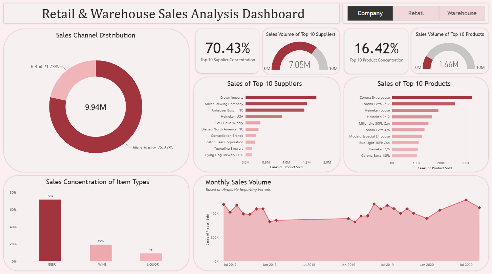

# Retail & Warehouse Sales Analysis

## Project Overview

This project analyzes beverage and supplier sales volume across retail and warehouse channels using SQL and Power BI.

The structured workflow of this analysis consists of database and table creation, data validation, data profiling, SQL analysis, and the development of an interactive Power BI dashboard. 

## Data Source
The dataset used in this project was obtained from Kaggle. 
- Dataset: https://www.kaggle.com/datasets/sahirmaharajj/retail-sales-analysis

## Key Findings

**Sales Channel:** 
- Warehouse sales accounted for 78.27% of total company sales volume, significantly exceeding retail sales volume.

**Supplier Analysis:** 
- The top 10 company suppliers accounted for 70.43% of total supplier sales volume. Sales volume among top suppliers were more concentrated in the warehouse channel than in the retail channel.

**Item Type Analysis:** 
- Beer accounted for 70.42% of total cases sold. Beer dominated warehouse sales, while retail sales volume was more evenly distributed across liquor, wine, and beer.

**Product Analysis:** 
- Sales volume was not heavily concentrated among top products in each sales channel. The top 10 company products accounted for 16.42% of total company sales volume, with the highest concentration in the warehouse channel and the lowest in the retail channel indicating that distribution of sales volume is highly diverse across many products.

## Dashboard Preview
The interactive dashboard allows users to compare retail and warehouse sales volume, supplier concentration, product concentration, item type distribution, and monthly reported sales volume through filtering.

## Tools & Skills

### PostgreSQL
- Database setup
- Data validation
- Data profiling
- SQL querying
- Exploratory data analysis

### Power BI
- Interactive dashboard creation
- Data visualization

### Power Query
- Data preparation
- Data transformation

## Dataset Limitations
- Annual sales performance could not be analyzed reliably due to inconsistent monthly reporting across years.
- Seasonality analysis could not be done reliably due to inconsistent monthly reporting across years.
- Customer analysis was not possible because customer data was unavailable.
- Multiple item descriptions were mapped to one item code. This led to product analysis being conducted using item codes rather than item descriptions.
- Retail transfer analysis was excluded from analysis due to a lack of business context regarding how it's used within business operations. 

## Project Workflow

### Database Setup & Validation (Files 00 - 01)
Created PostgreSQL database and table, imported data, and performed data validation to identify any NULL values and any duplicated rows of data.

### Data Profiling (File 02)
Profiled the dataset to understand the data, assess data quality, and identify inconsistencies in the data that could impact analysis.

### Dataset Overview & Business Questions (Files 03 - 04)
Documented dataset overview, column definitions, and dataset limitations. Based on that, established business questions from various internal stakeholder perspectives to guide the analysis.

### Data Analysis (Files 05 - 08)
Analyzed sales channels, sales volume concentration of top suppliers, item type sales distribution, and sales volume concentration of top products to identify sales distribution and concentration patterns. 

### Findings & Reporting (Files 09-10)
Summarized key findings and insights. Created datasets for export used to develop the Power BI dashboard.

### Dashboard Development
Built an interactive Power BI dashboard to visualize sales volume and compare retail and warehouse sales channels. Occasionally used Power Query to clean the data in preparation for visualizations.
