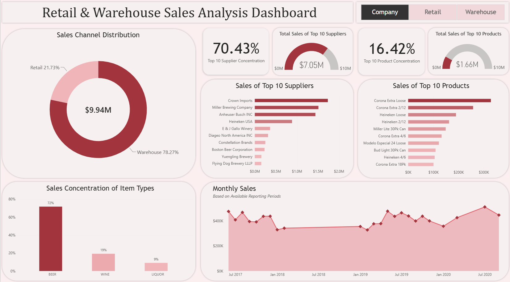

# Retail & Warehouse Sales Analysis

## Project Overview

This project analyzes beverage and supplier sales across retail and warehouse channels using SQL and Power BI.

The structured workflow of this analysis consists of database and table creation, data validation, data profiling, SQL analysis, and the development of an interactive Power BI dashboard. 

## Key Findings

**Sales Channel:** 
- Warehouse sales accounted for 78.27% of total company sales, significantly exceeding retail sales.

**Supplier Analysis:** 
- The top 10 company suppliers accounted for 70.43% of total supplier sales. Sales among top suppliers were more concentrated in the warehouse channel than in the retail channel.

**Item Type Analysis:** 
- Beer accounted for 70.42% of total company sales. Beer dominated warehouse sales, while retail sales were more evenly distributed across liquor, wine, and beer.

**Product Analysis:** 
- Sales were not heavily concentrated among top products in each sales channel. The top 10 company products accounted for 16.42% of total company sales, with the highest concentration in the warehouse channel and the lowest in the retail channel.

## Dashboard Preview
The interactive dashboard allows users to compare retail and warehouse sales performance, supplier concentration, product concentration, item type distribution, and monthly reported sales through filtering.

## Tools & Skills

### PostgreSQL
- Database setup
- Data validation
- Data profiling
- SQL querying
- Exploratory data analysis

### Power BI
- Interactive dashboard creation
- Data visualization

### Power Query
- Data preparation
- Data transformation

## Dataset Limitations
- Annual sales performance could not be analyzed reliably due to inconsistent monthly reporting across years.
- Seasonality analysis could not be done reliably due to inconsistent monthly reporting across years.
- Customer analysis was not possible because customer data was unavailable.
- Multiple item descriptions were mapped to one item code. This led to product analysis being conducted using item codes rather than item descriptions.
- Retail transfer analysis was excluded from analysis due lack of business context regarding how it's used within business operations. 

